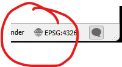
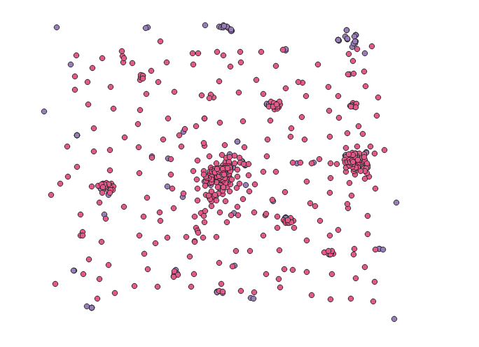
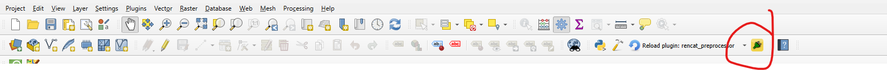
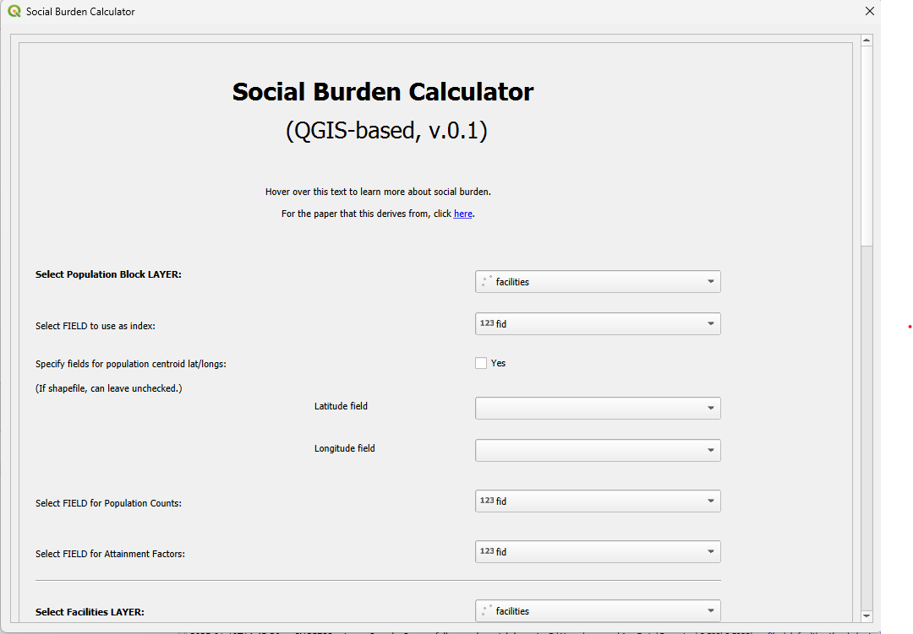
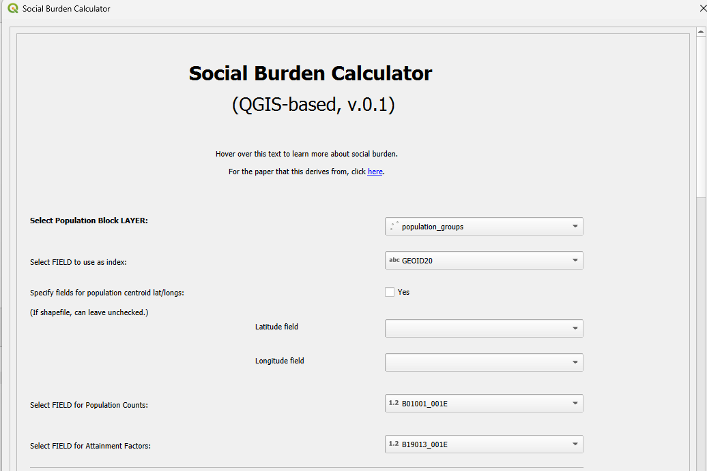
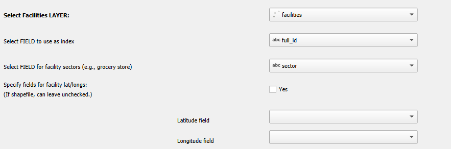
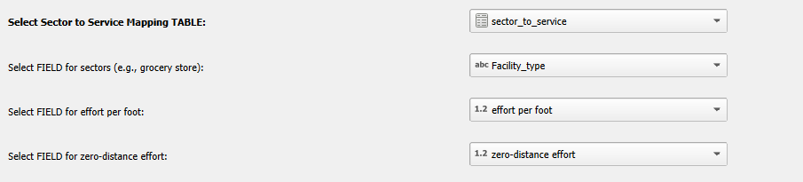
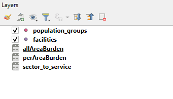
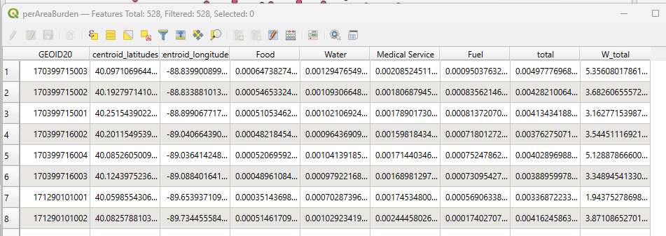
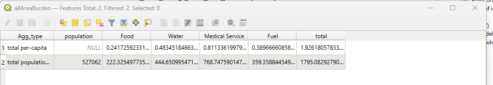

# QGIS social burden plugin example

This readme is intended to walk a novice user through the flow of using the QGIS plugin on an example toy dataset.

The data for use in this example are available in this folder. 

## Sources: 
The population data is adapted from data from the US 2020 Census. It 
covers a portion of the US state of Illinois, chosen arbitrarily.

The facility information is from OpenStreetMap, and was collected via QuickOSM. For the OpenStreetMap license, 
please see the ODBL-LICENSE text file in this folder.

The sector to service mapping is hypothetical and should not be used in research scenarios.

## Files

The examples folder, in which this document is located, contains four other files:
 
- facilities.gpkg : a geopackage containing a set of facilities located in or near the area of interest,
 of three different infrastructure types
 
- population_data.gpkg : a geopackage containing a set of population groups constituting the area of interest

- sector_to_service.csv : a csv file containing the mapping from sectors to services

- sector_to_service.csvt : a metadata file containing type information for the .csv file of the same name; 
used to simplify import of the csv into QGIS

## 0. Install and acquire files

1. If you have not already installed the plugin, please do so according to the instructions 
in the top folder's readme (the long readme with all the vocab descriptions).

2. If you have not already downloaded the files in this folder (and unzipped them if nececessary), do so.

## 1. Import data

1. If QGIS is not already open, open it.

2. Check the CRS (coordinate reference system) of your current project. Unless you 
are an expert user, it's better to have your project be in the same CRS as the example files, which is EPSG:4326. 
The project CRS is listed in the bottom right-hand corner of the QGIS window, next to a little "globe with a hat"-looking icon.

To change the CRS, click that icon and in the pop-up menu, select EPSG:4326 as the CRS. Then click the "Ok" button in the lower right of the window.

3. Drag the geopackages (.gpkg) and csv files from the unzipped folder, and drop them into the "Layers" portion 
of the window, or otherwise import them into QGIS.

Note: you will want to check that the sector to service table has been imported properly. 
After import, in the Layers menu, right-click on "sector_to_service" and click "Properties", then in the resulting
pop-up window, click "Fields". The "Type" column should say "Text (string)" for the first row and "Decimal (double)" 
for the rest. If this is not the case, remove this layer and re-import manually using 
Layer -> Add Layer -> Add Delimited Text Layer from the QGIS main toolbar and specify 
the data types when importing the file.

The figure below shows what the facilities and population groups look like, although colors may differ.

## 2. Open the plugin 

Click on the icon in the QGIS toolbar representing the QGIS social burden plugin.

The resulting menu will look something like this: 

Unless otherwise indicated, the remaining steps in this tutorial will take place in the plugin's menu.

## 3. Fill out population information

1. In the first dropdown, select the layer that represents the population locations and data. In our case, this is the "population_data" layer.

2. In the next dropdown, select the field that acts as the index for the population data. In our case,  this is the GEOID20 field.

3. For this example, skip the check-box and the two dropdown fields for information about population centroid lat/lons. Since the population is represented by points, this is not needed.

4. Select the dropdown field providing the population counts. In our example, this is the field called B01001_001E, which is the US Census data code for estimated population at the block group level.

5. Select the dropdown field providing the attainment factors. In our example, this is the field called B19013_001E, which is the US Census data code for estimated median income.

Filled out, this looks like: 

## 4. Fill out facilities information

1. Select the layer from the dropdown that represents the facilities' locations and data. In our case, this is the "facilities" layer.

2. Select the field that acts as the index for the facilities. In our case, we can use the "full_id" field, but this is somewhat arbitrary.

3. Select the field that represents the sector labels for the facilities. In this example, this is the "sector" field.

4. In this example, ignore the remaining checkbox and dropdowns for this section: the lat/lons for the facilities are already known because the layer is a vector layer of points.

Filled out, this looks like: 

## 5. Fill out sector to service information

1. Select the sector_to_service table.

2. Select the field that provides the list of sectors. In this case it is called "Facility_type".

3. Select the effort per foot field.

4. Select the zero-distance effort field.

## 6. Fill out exclusion profile section

That is, in this example, leave it blank. More detail on this option is provided in the main set of instructions.

## 7. Fill out the information for exporting to text file

That is, in this example, leave it blank. More detail on this option is provided in the main set of instructions.

## 8. Fill out ReNCAT export/import information

Leave it blank in this example. More detail on these options is provided in the main set of instructions.

## 9. Hit ok

The menu will close at this point, and QGIS may spend a few seconds processing, at which point two tables will appear in the layer listing. 

To view each results table, right-click on the layer name in the Layers panel, then select "Open Attribute Table" in the resulting dropdown menu.

The perAreaBurden represents how much burden each population group experiences in each sector, 
as well as an aggregated field and one that is weighted by population (so the aggregate
 burden over all sectors, for the entire population of that group rather than per-capita)
 
 A screencap of a portion of the perArea results: 
 
 
 
The aggregated burden values represent per-capita and weighted (by all populations) burden across the entire area. Screencap: 

